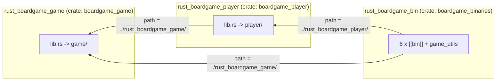
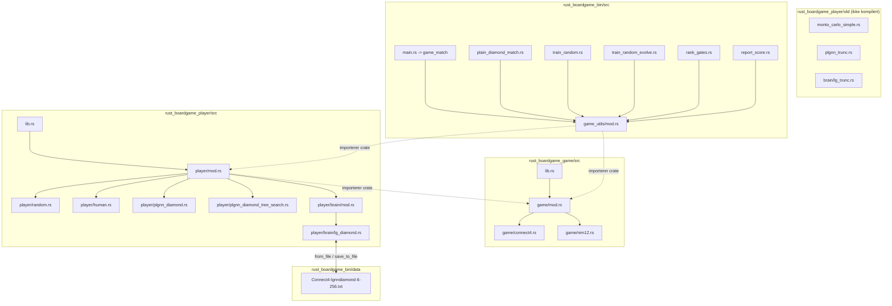
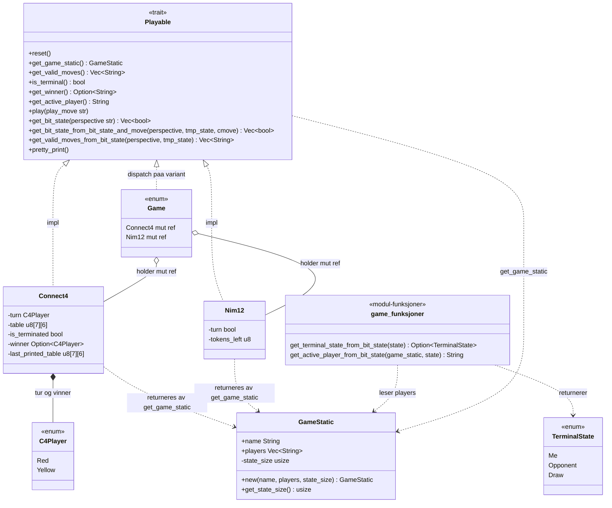
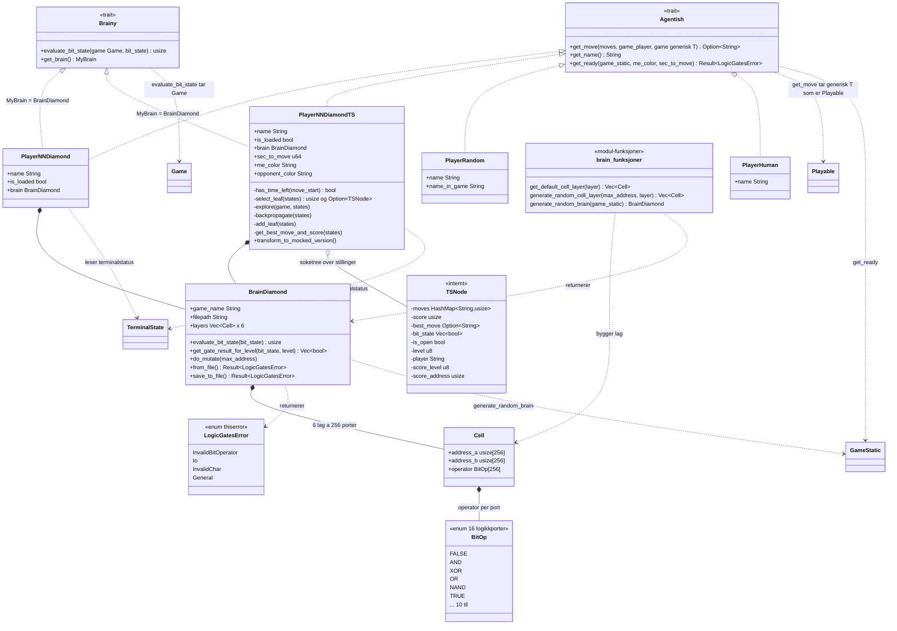
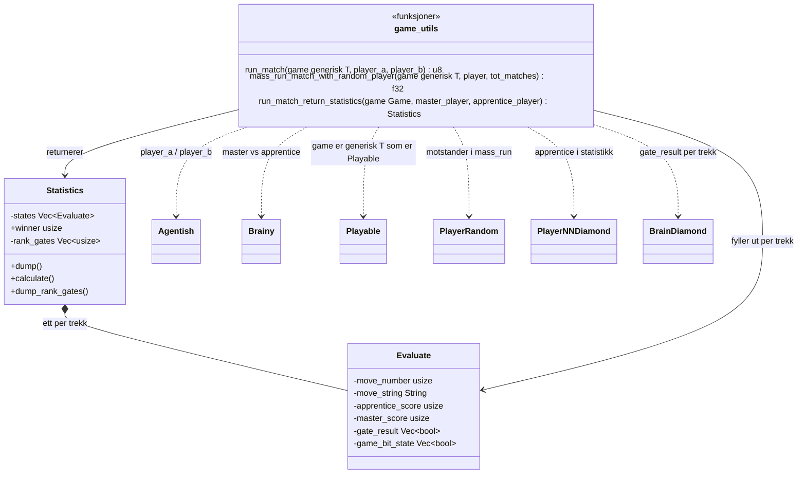
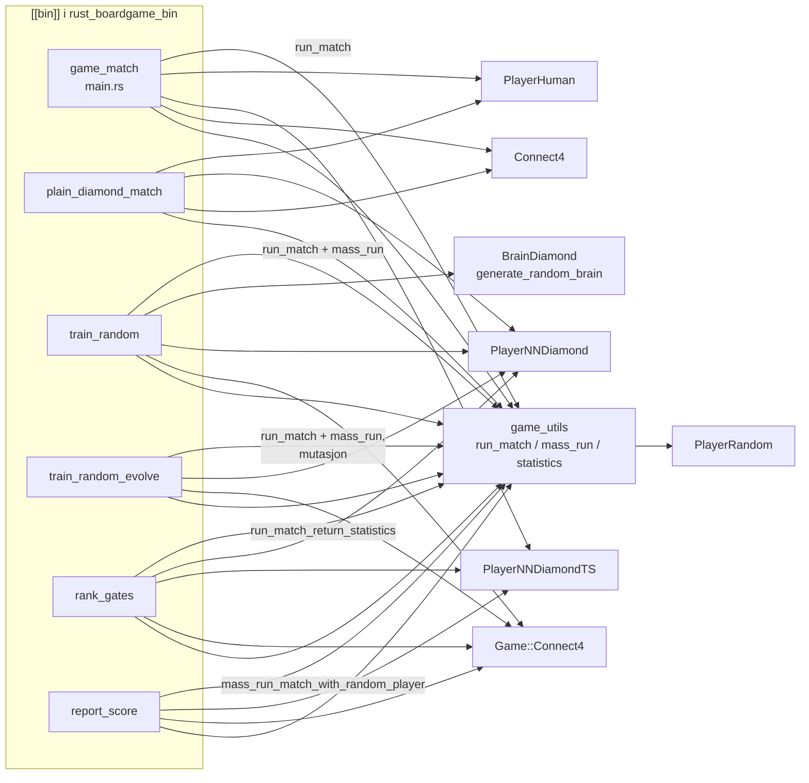
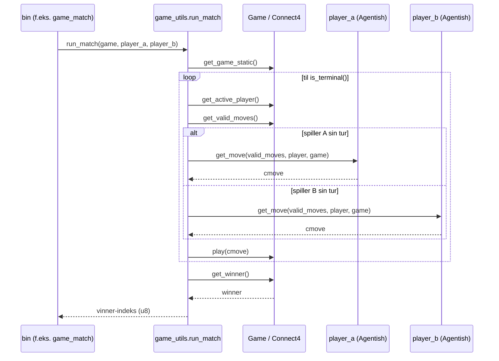

# Objekt- og filmodell for rust_boardgame_*-repoene

Modellen dekker de tre repoene som hører sammen:

| Repo | Crate | Type | Innhold |
|------|-------|------|---------|
| `rust_boardgame_game` | `boardgame_game` | bibliotek | spillregler (spill-objekter) |
| `rust_boardgame_player` | `boardgame_player` | bibliotek | spillere/agenter og "hjerner" (logikkport-nettverk) |
| `rust_boardgame_bin` | `boardgame_binaries` | binærer | kjørbare programmer + kamp-logikk (`game_utils`) |

Diagrammene er Mermaid. De kan vises direkte på GitHub/GitLab, i VS Code
(Markdown Preview Mermaid), eller på <https://mermaid.live>.

Samme modell finnes i to alternative formater for sammenligning:
`objektmodell.d2` (D2, rendres med `d2 objektmodell.d2 objektmodell.svg`) og
`objektmodell.puml` (PlantUML, rendres med `plantuml objektmodell.puml`).

---

## 1. Avhengigheter mellom crates

`boardgame_binaries` er toppen av haugen og eier alle `[[bin]]`-programmene.
`boardgame_game` er den eneste som ikke avhenger av de andre.

---

## 2. Filer og moduler

`old/`-katalogen ligger utenfor `src/` og kompileres ikke. Den er en tidligere
variant av samme mønster (`Brain`/`Layer`, `PlayerMCS`, `PlayerNeuralNetwork`).

---

## 3. Objektmodell – spill (`boardgame_game`)

Kjernegrensesnittet er traiten `Playable`. Alle spill implementerer den, og
enumen `Game` videresender til dem.

**Bit-tilstand:** `get_bit_state` returnerer en `Vec<bool>` per posisjon.
Indeksene 2-6 har fast betydning (brukt av hjelpesfunksjonene):
`state[2]`/`state[3]` = tur, `state[4]` = uavgjort, `state[5]` = "jeg vinner",
`state[6]` = "motstander vinner".

---

## 4. Objektmodell – spillere og hjerner (`boardgame_player`)

To traits: `Agentish` (velger trekk) og `Brainy` (vurderer stilling via en
hjerne). Alle agenter implementerer `Agentish`; de nevrale spillerne
implementerer i tillegg `Brainy` med `MyBrain = BrainDiamond`.

**Hjernens oppbygging:** `BrainDiamond` er et rent logikkport-nettverk med
`NO_LAYERS = 6` lag og `CELL_SIZE = 256` porter per celle. Hver `Cell` har to
inngangsadresser (`address_a`/`address_b` peker på bits i forrige lag) og en
`BitOp` per port. Nettverket serialiseres til tekst
(`data/<spill>-lgnndiamond-6-256.txt`, format `Layer:`/`Data:`/`adr_a,adr_b,OP`)
via `from_file`/`save_to_file`, og muteres med `do_mutate`.

**Tresøk:** `PlayerNNDiamondTS` bygger et tre av `TSNode` (velg blad,
utforsk, backpropager, legg til blad) og scorer bladene med
`BrainDiamond::evaluate_bit_state` / `get_gate_result_for_level`.

---

## 5. Objektmodell – binærer og kamp-logikk (`boardgame_binaries`)

`game_utils` er en delt modul (inkludert med `mod game_utils;` i hver binær)
med kamp-driveren og statistikk-objektene.

### Hvilken binær bruker hva

| Binær | Formål | Oppsett |
|-------|--------|---------|
| `game_match` | spille et parti mot menneske | `PlayerNNDiamondTS` vs `PlayerHuman` på `Connect4` |
| `plain_diamond_match` | parti uten tresøk | `PlayerNNDiamond` vs `PlayerHuman` på `Connect4` |
| `train_random` | tilfeldig trening av hjerne | to `PlayerNNDiamond` spiller mot hverandre, vinneren beholdes, måles mot `PlayerRandom` |
| `train_random_evolve` | trening med mutasjon | som over, men hjernen muteres mellom generasjoner |
| `rank_gates` | ranger portene i hjernen | `PlayerNNDiamondTS` (master) vs `PlayerNNDiamond` (apprentice) gir `Statistics::calculate` |
| `report_score` | mål styrke | `PlayerNNDiamondTS` vs `PlayerRandom` (1000 partier) |

---

## 6. Kjøreflyt for ett parti (`run_match`)

For `PlayerNNDiamondTS` skjer alt i `get_move`: den bygger/utvider et tre av
`TSNode`, scorer bladene med `BrainDiamond`, og returnerer beste trekk innen
`sec_to_move` sekunder.

---

## 7. Ordbok (domeneterminologi)

| Begrep | Objekt | Betydning |
|--------|--------|-----------|
| Spill | `Connect4`, `Nim12` | regler og brett-tilstand, implementerer `Playable` |
| Statisk spill-info | `GameStatic` | navn, spillernavn, antall bits i tilstanden |
| Agent / spiller | `Player*` | velger trekk, implementerer `Agentish` |
| Hjerne | `BrainDiamond` | logikkport-nettverk som scorer stillinger |
| Celle / port | `Cell`, `BitOp` | 256 porter med to inngangsadresser og en operator |
| Bit-tilstand | `Vec<bool>` | flatt stillingsformat, sett fra én spillers perspektiv |
| Trekk | `String` (f.eks. `"3"`) | felles format på tvers av spill |
| Master / apprentice | `Brainy`-spillere | master vurderer, apprentice spiller i `rank_gates` |
| Gate-rangering | `Statistics::rank_gates` | hvilke porter som minst bidrar til beste trekk |
| Tresøk | `TSNode`-tre i `PlayerNNDiamondTS` | utforsk/backpropager før trekkvalg |
